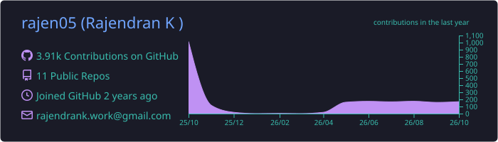
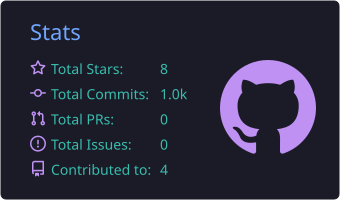
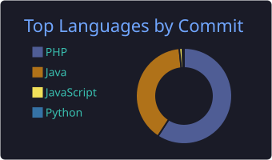

  

  

  
  
  
  

## 👋 About Me

Second-year **Computing Science** student at **Heriot-Watt University Malaysia**, based in **Kuala Lumpur**. I'm interested in how data and AI can solve real-world problems.

- 🔬 Learning more about **Machine Learning**, **AI models** and **Data Analytics**
- ⚙️ Building AI-powered automation for SMEs at **Sennova AI**
- 💡 I enjoy turning raw data into insights and building systems that run themselves
- 🎯 Open to **internships** in data science and AI

## 🛠️ Tech Stack

**Languages & Data** 

**Web & Design** 

**Cloud & Hardware** 

**Analytics & BI** 

## 📊 GitHub Stats

  

  
  

  

## 🕹️ Contributions

  <picture>
    <source media="(prefers-color-scheme: dark)" srcset="https://raw.githubusercontent.com/rajen05/rajen05/output/pacman-contribution-graph-dark.svg">
    <source media="(prefers-color-scheme: light)" srcset="https://raw.githubusercontent.com/rajen05/rajen05/output/pacman-contribution-graph.svg">
    
  </picture>

  

