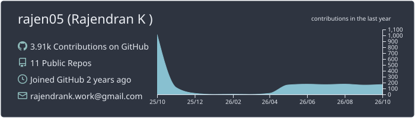
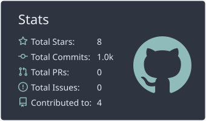
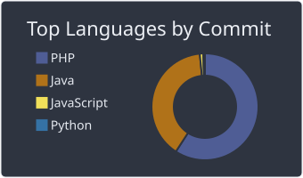

You can find me on [LinkedIn](https://www.linkedin.com/in/rajendran-k-877a83318/), email me at [rajendrank.work@gmail.com](mailto:rajendrank.work@gmail.com), or message me on [Discord](https://discord.com/users/849998175036768316).

### What I work with

Mostly Python, R and SQL for data work, with Tableau and Power BI when something needs to be shown to people. Java and JavaScript come up in uni and client projects.

### Activity

 

<picture>
  <source media="(prefers-color-scheme: dark)" srcset="https://raw.githubusercontent.com/rajen05/rajen05/output/pacman-contribution-graph-dark.svg">
  <source media="(prefers-color-scheme: light)" srcset="https://raw.githubusercontent.com/rajen05/rajen05/output/pacman-contribution-graph.svg">
  
</picture>
