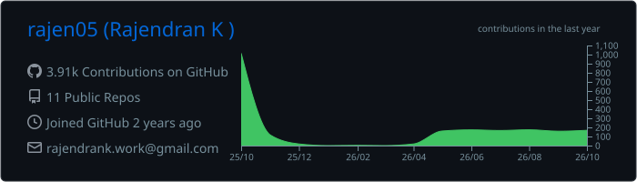
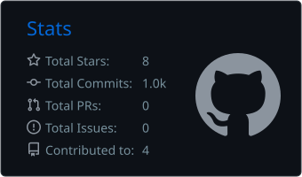
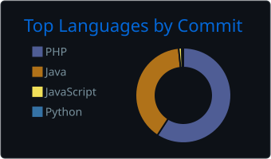

  
  
  
  

### Activity

 

<picture>
  <source media="(prefers-color-scheme: dark)" srcset="https://raw.githubusercontent.com/rajen05/rajen05/output/pacman-contribution-graph-dark.svg">
  <source media="(prefers-color-scheme: light)" srcset="https://raw.githubusercontent.com/rajen05/rajen05/output/pacman-contribution-graph.svg">
  
</picture>
